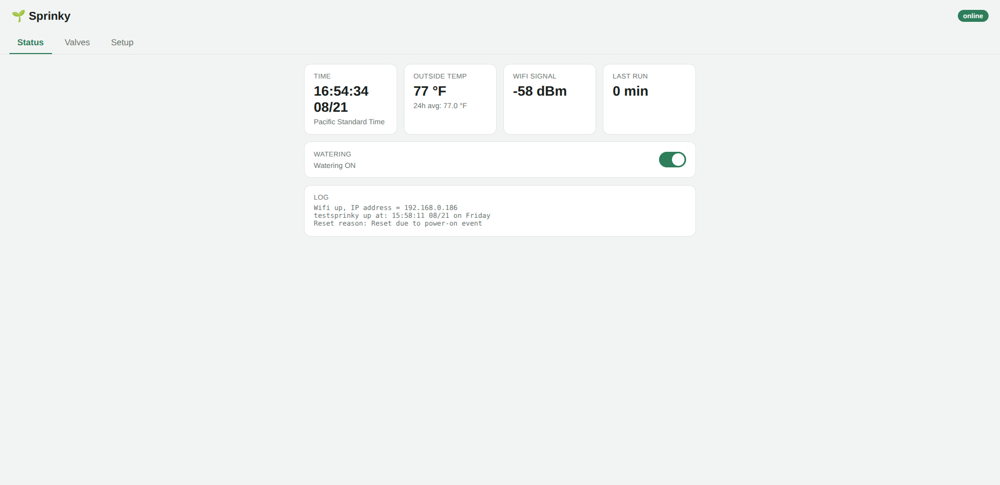
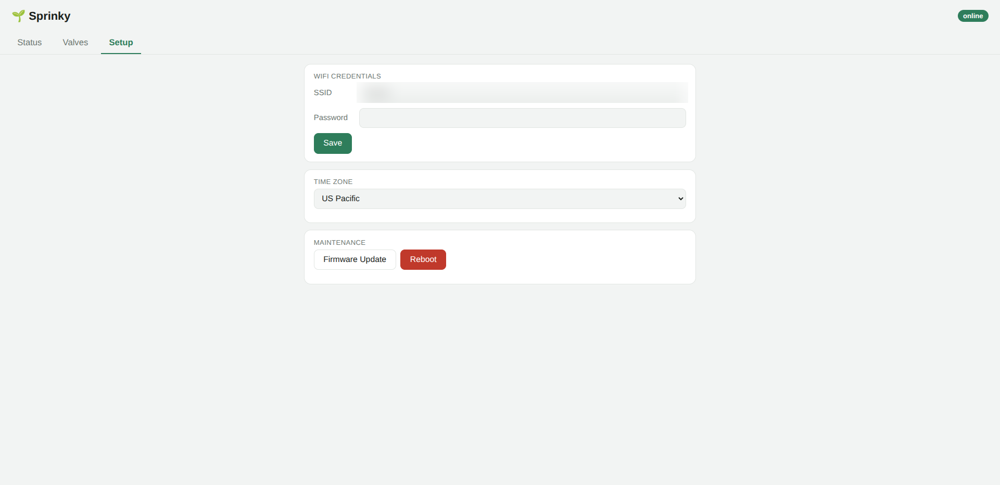
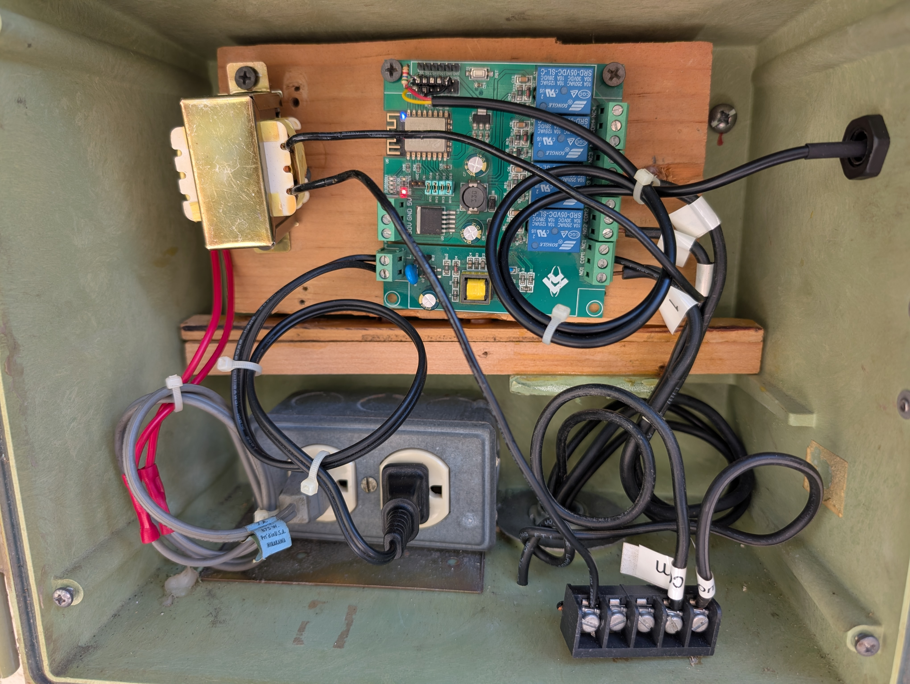
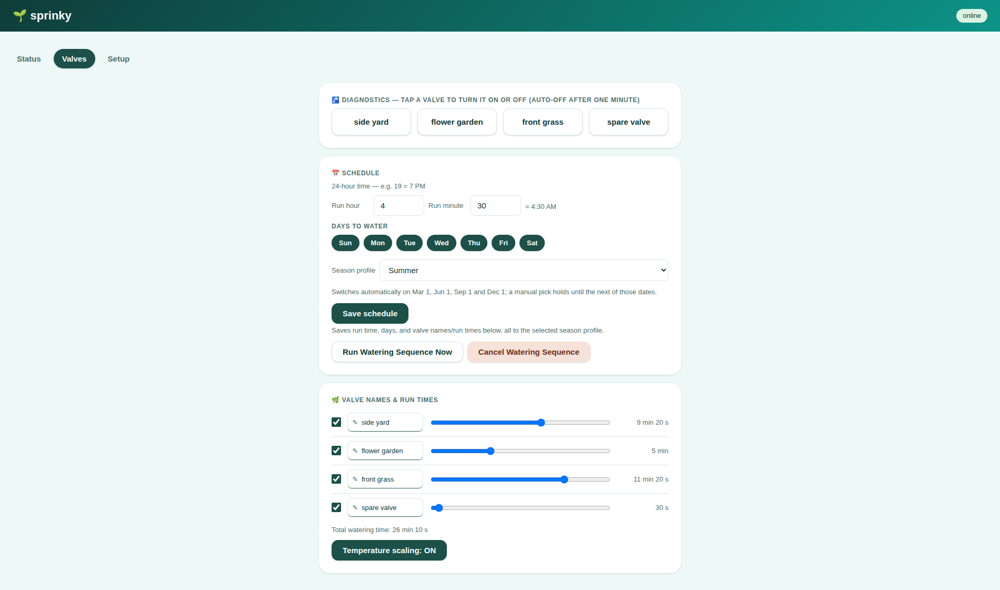

# Sprinky

A WiFi-connected landscape sprinkler controller for the ESP32 and ESP8266,
with a clean web dashboard and temperature-adjusted watering times.

<p align="center">
  
  
</p>

## Why Sprinky is easy to set up

Sprinky is designed to run on almost any ESP32 or ESP8266 relay board you
can find — the cheap multi-relay boards sold for home automation projects
(the kind commonly found from Chinese sellers on Alibaba/AliExpress/eBay)
work fine, as do hand-wired boards. There's no proprietary hardware
requirement and no PCB to order.

**The only thing you have to configure for your specific board is which
GPIO pins drive your relays.** That's a single array in `config.h`:

```cpp
static const uint8_t relay[] = { 32, 33, 25, 26, 27, 14, 12, 13 };
```

Replace those pin numbers with whichever GPIO pins your board actually
wires to its relay inputs (check your board's silkscreen or datasheet),
set `RELAY8` (below) to match how many valves you have, and you're
running. Everything else — scheduling, seasonal profiles, the web UI,
WiFi setup, temperature scaling, OTA updates — works identically
regardless of which board you used.

<p align="center">
  
  <br>
  <em>An example 8-relay board wired into a weatherproof enclosure — any similar board works.</em>
</p>

A temperature sensor is **optional**. Sprinky waters on schedule either
way, and when it's online it can adjust run times to the weather using
free data from Open-Meteo, with no sensor at all. A sensor adds a backup
for when that data isn't available. See
[Temperature-adjusted watering](#temperature-adjusted-watering) below.

## What you need

- An ESP32 or ESP8266 development board
- A relay board (4 or 8 channel) to switch your sprinkler valves' solenoids
- *(Optional)* A DS18B20 temperature sensor, or a silicon diode (e.g.
  1N914) wired to the A0 analog input, as a backup for temperature-adjusted
  watering when online weather data isn't available
- A USB cable to flash the firmware the first time (updates after that can
  go over WiFi — see [Firmware updates](#firmware-updates))

No app to install, no cloud account, no subscription. Once flashed, you
control everything from a web page served by the device itself.

## Quick start

This is a [PlatformIO](https://platformio.org/) project. There is no
`.ino` sketch — the firmware is the `src/*.cpp` / `src/*.h` files
(`config.h` is in `src/` too), and all library versions are pinned in
`platformio.ini`.

1. **Install PlatformIO** — either the
   [PlatformIO IDE extension for VS Code](https://platformio.org/install/ide?install=vscode)
   or the CLI (`pip install platformio`).
2. **Open the project folder.** PlatformIO reads `platformio.ini` and
   downloads every pinned dependency automatically the first time you
   build — nothing to install by hand. (The required
   `ELEGANTOTA_USE_ASYNC_WEBSERVER=1` flag is already set there in
   `build_flags`, so OTA updates share the dashboard's web server.)
3. **Edit `config.h`** for your hardware (see [Configuring your hardware](#configuring-your-hardware)
   below) — at minimum, set the `relay[]` pin array to match your board's
   wiring and set `RELAY8` to match your valve count.
4. **Build and flash over USB:**
   - ESP8266: `pio run -e esp12e -t upload`
   - ESP32: `pio run -e esp32dev -t upload`

   (In the VS Code extension, pick the environment and hit Upload.) Watch
   the serial log with `pio device monitor` (115200 baud).
5. **Connect to the controller.** On first boot (or any time it can't
   connect to a saved WiFi network), it creates its own WiFi access point
   named after `HOSTNAME` in `config.h`, reachable at `192.168.4.1`.
   Connect to that network with your phone or laptop, open
   `http://192.168.4.1` in a browser, and enter your home WiFi's SSID and
   password on the Setup tab.
6. **Reboot** (or it will reconnect automatically) and the controller
   joins your WiFi network. From then on, find it at
   `http://<HOSTNAME>.local/` (mDNS) from any device on the same network.

   If the saved network doesn't answer at boot (for example the router is
   still starting after a power cut), the access point comes up again,
   and Sprinky keeps trying the saved network once a minute (every 5 minutes
   after the first 10 tries), pausing while a device is connected to the
   access point. When it gets through
   it switches the access point off.

That's the whole setup. Everything past this point — naming valves,
setting run times, scheduling — is done from the web dashboard, no
re-flashing required. For your first few weeks, we recommend running
with temperature scaling off — see
[Recommended: set up with scaling off first](#recommended-set-up-with-scaling-off-first).

## Using the dashboard

Once connected, the web dashboard has three tabs:

- **Status** — current time, outside temperature (with a °F / °C toggle
  button), 24-hour average temperature, WiFi signal strength and the
  device's IP address, last completed run's total duration, a master
  watering on/off switch, and a live debug log.
- **Valves** — a "test" button per valve (runs it for up to a minute,
  useful for checking wiring or manually watering one zone), an editable
  name and run-time slider per valve, which days of the week the schedule
  is allowed to run on, and the daily start time (entered in 24-hour time,
  with a live 12-hour readout next to it so an evening schedule can't be
  mistaken for a morning one), plus a "Run Watering Sequence Now" button to
  trigger the full schedule on demand and a "Cancel Watering Sequence"
  button that stops a running sequence and closes every valve. This tab
  also has a **Temperature
  scaling** on/off toggle and a **season profile** selector (see
  [Seasonal schedule profiles](#seasonal-schedule-profiles) below).
- **Setup** — WiFi credentials, time zone selection (US zones plus common
  world zones — UK/GMT, Central European, Moscow, Australia Eastern,
  Brazil, South Africa, Gulf/Dubai, India, China, Japan), the site
  **location** (see below), a link to the firmware update page, and a
  reboot button.

**Location.** Sprinky needs its latitude and longitude for temperature
scaling and to pick the right season dates. There's nothing to set up:
after each boot it looks up an approximate location (usually your city)
from your internet connection, using the free [ip-api.com](https://ip-api.com)
service. The Location card on the Setup tab shows the result. If it's
wrong — some internet providers report a city far away — type your own
latitude and longitude (decimal degrees, north and east positive; any map
app will show them) and press **Save**. Values you enter are kept until you
press **Use automatic location**. If the lookup fails, Sprinky uses the
last location it found, or the defaults in `config.h`.

<p align="center">
  
</p>


Changes you make (valve names, run times, schedule, WiFi credentials,
time zone, location) are saved to the device's flash storage and survive power
loss and reboots.

## The clock

Sprinky normally takes the time from the internet (NTP). So that a power
cut or an internet outage doesn't stop the schedule, it also:

- **saves the time to flash every hour** and starts from that after a
  restart, until internet time arrives. After a power cut the clock is
  therefore late by about as long as the power was off (plus up to an
  hour), and watering happens that much late;
- **takes the time from your browser** whenever the dashboard is open and
  there is no internet time. This also makes Sprinky usable with no
  internet at all: connect to its access point, set the time zone on the
  Setup tab, and the clock is set from your phone or laptop.

The Time card on the Status tab says when the clock isn't on internet
time. A controller whose clock has never been set (new, and never online
or opened in a browser) doesn't run the schedule; **Run Watering Sequence
Now** still works.

## Scheduling

Set a daily start time and which days of the week to water on. When that
time arrives (and today is an active day), Sprinky runs through each
valve in sequence for its configured duration, one at a time — never more
than one valve open at once.

**Missed runs.** If Sprinky can't start a run on time (a power cut, a
reboot, or the hour that doesn't exist on the night daylight saving
starts), it starts the run as soon as it can, up to 3 hours late
(`CATCHUP_MINUTES` in `config.h`) and only on the same calendar day. It
remembers in flash that the day's run has started, so a reboot doesn't
water twice. Two things follow from this:

- Turning **Watering** back on, or enabling today in **Days to Water**,
  within 3 hours after the start time starts today's run straight away if
  it hasn't run yet.
- Changing the start time to one that has already passed today doesn't
  start a run; the new time first applies tomorrow.

A run that is interrupted part-way (by a reboot, say) is not resumed.

Several independent safeguards keep a valve from being left running:

- **Hard limits** in `config.h` that don't depend on the schedule or the
  temperature scaling: no valve stays open longer than
  `MAX_VALVE_SECONDS` (2 hours) in one go, and all valves together are
  open no longer than `MAX_DAILY_SECONDS` (8 hours) per day. Past the
  daily limit everything closes and nothing opens again until the next
  day. (The daily count is kept in memory, so a reboot restarts it.)
- An optional **master valve**, with an optional "dead-man" circuit that
  closes it if the processor stops: see
  [Master valve](#master-valve-optional).
- A **cycle safety timer** force-stops the whole cycle 5 minutes after it
  should have finished.
- A manually-triggered **valve test** shuts off automatically after a
  minute, so a network hiccup or a forgotten browser tab can't leave it
  running.
- A **valve watchdog**, checked continuously and independent of the
  timers, closes any valve that has stayed open more than a minute past
  its run time and logs a `SAFETY:` line on the Status tab.
- If the firmware ever hangs, the chip's watchdog resets it, and every
  valve is closed at boot.

Software can't detect a welded relay or a mechanically stuck valve,
though — see [A note on reliability](#a-note-on-reliability).

## Master valve (optional)

A master valve sits upstream of all the zone valves on a relay of its
own. Sprinky opens it whenever a zone valve is open and closes it when
the zone closes, so a zone valve that sticks open, or a zone relay that
welds shut, can't flood by itself: two things have to fail.

To use one, add a relay for it (a one-channel relay module is enough; the
board's built-in relays all stay as zones) and set the GPIO that drives
it in `config.h`:

```cpp
#define MASTER_VALVE_PIN 4
```

The pin must not be one of the `relay[]` pins (the build stops with an
error if it is). It's driven at the same active level as the zone relays
(`RELAY_ACTIVE`). The Valves tab then shows whether the master valve is
open.

Which pin: on an ESP32, any spare GPIO. On a 4-relay ESP8266 board, a
spare GPIO such as GPIO4 (GPIO5 is taken if a DS18B20 is fitted). On an
8-relay ESP8266 board only GPIO2 is left: you lose the heartbeat LED, and
the pin sends a short burst of boot messages at power-up.

### Dead-man circuit

A steady level on a pin can't tell "valve should be open" from "the
processor has frozen with the pin high". With

```cpp
#define MASTER_VALVE_PULSED
```

as well, the master pin puts out a square wave (about 500 Hz) while a
valve is open, and only from the main loop, so it stops if the firmware
stops. The circuit below turns that square wave into relay drive. A pin
stuck high or low passes nothing through C1, and the relay drops out.

```
+3.3V ─────────────┬───────────┬───────────┬───────────────┐
                   │ K         │ +         │               │ E
                  ─┴─         ─┴─         ┌┴┐            ┌─┘
               D1  ▲       C2 ─┬─      R2 │ │          B │   Q1 BC557 (PNP)
                   │ A    10µF │     220k └┬┘     ┌──────┤
       R1     C1   │           │           │  R3  │      └─┐
GPIO ─[330Ω]──┤├───● N         ● O ────────●─[22k]┘        │ C
              1µF  │           │                           │
           ceramic │ K  D2   A │                           │
                   └────|◄─────┘                           │
                                                           │
                          ┌────────────[R4 2.2k]───────────┘
                          │
                          │        +5V ────┬─────────────┐
                          │                │ K           │
                          │               ─┴─          ┌─┴─┐  K1: 5 V relay coil
                          │            D3  ▲           │   │  (about 70 Ω, 70 mA)
                          │        1N4007  │ A         └─┬─┘
                          │                └─────────────┤
                          │                              │ C
                          │                    B       ┌─┘
                          ●────────────────────────────┤     Q2 BC337 (NPN)
                          │                            └─┐
                         ┌┴┐                             │ E
                      R5 │ │ 10k                         │
                         └┬┘                             │
GND ──────────────────────┴──────────────────────────────┴──── board GND


K1 contacts (normally open):   24 VAC ────o  o──── master valve solenoid ──── 24 VAC common
```

D1 and D2 are 1N4148 (D1: anode at N, cathode at +3.3 V; D2: cathode at
N, anode at O). D3 is the flyback diode across the coil, cathode to +5 V.
A one-channel relay module with a high-level trigger can replace R4, R5,
Q2, D3 and K1: connect Q1's collector to its input, with 10 kΩ to ground
if the module has no pull-down.

**Status of this circuit:** it has been simulated (ngspice), not built.
In simulation the relay pulls in within 10–90 ms for square waves from
40 Hz to 2 kHz, rides through a 0.3 s pause, and drops out 0.6–0.9 s
after the pin freezes high or low. Check it on the bench before trusting
it. Each time the master valve closes, the Status log shows the rate the
firmware actually achieved (`Master valve pulse averaged … Hz`).

## Seasonal schedule profiles

The Valves tab has a **season profile** selector (Summer / Fall / Winter /
Spring). Each season stores its own complete schedule — start time, active
days, and every valve's name and run time — so you can set watering up
once per season and switch between them instead of re-entering everything.

- **Automatic switching:** Sprinky switches to the matching profile on
  Mar 1 (Spring), Jun 1 (Summer), Sep 1 (Fall) and Dec 1 (Winter), once
  its clock has synced over the network. The seasons are flipped for the
  southern hemisphere (a negative latitude on the Setup tab). It never
  switches in the middle of a watering cycle.
- **Manual override:** selecting a season in the dropdown immediately
  loads that profile's saved schedule and makes it the active one. A
  manual pick holds until the next of those dates, then automatic
  switching takes over again. The active season is kept across reboots.
- **"Save schedule"** writes the fields currently on screen into the
  selected season's slot.
- Only one profile is active at a time.

On first boot after updating to this firmware, your existing schedule is
copied into the **Summer** profile, so nothing is lost.

The Temperature scaling toggle is a single global setting, not per-season.

## Rain skip

When a scheduled run is due, Sprinky asks Open-Meteo about rain at your
location and skips that day's run for any of three reasons. The Status tab
logs what it found and why it watered or skipped.

**1. Recent rain.** Any of these is met:

| Rain in the last… | Skip if at least |
|---|---|
| 24 hours (including now) | 2.5 mm (0.1") |
| 48 hours | 13 mm (0.5") |
| 72 hours | 25 mm (1") |

**2. Rain still in the soil.** Sprinky adds up the last 7 days: each day's
rain beyond the first 1 mm (which only wets leaves and mulch) is banked, up
to 15 mm (about what a lawn's root zone holds), and each day's
evapotranspiration (ET₀) uses some of it up. The run is skipped while at
least half a day's worth is left. A good soaking in cool weather therefore
holds watering off for a week or more, where the table above gives up
after three days.

**3. Rain on the way.** At least 5 mm is forecast for the next 24 hours,
counting only hours where rain is 70% likely or more. Because forecasts
miss, this never skips two runs in a row, and it's not used when the next
scheduled day is more than 2 days away.

For example:

```
Rain fallen: 24h 0.0mm, 48h 3.1mm, 72h 11.6mm. Still banked in soil: 6.2mm (skip at 0.6mm = half of yesterday's ET0)
Skipping watering: earlier rain still covers today's need
```

The Last Run card shows the most recent skip and the rain still banked;
`/api/status` has them as `lastSkip` and `rainCreditMm`. The amounts are in
`config.h` (`RAIN_SKIP[]`, `RAIN_INTERCEPT_MM`, `RAIN_CREDIT_MAX_MM`,
`RAIN_FORECAST_MM`, `RAIN_FORECAST_MIN_PROB`): for sandy soil or shallow
roots lower `RAIN_CREDIT_MAX_MM`, for clay raise it.

Rain skip is always on, works whether or not temperature scaling is on,
and never blocks **Run Watering Sequence Now**. If Open-Meteo can't be
reached, Sprinky waters as normal. Open-Meteo's rainfall is modeled for a
1–10 km area, not measured in your yard, so a very local shower can be
missed. It's only checked when the run starts: rain that begins during a
run doesn't stop it.

## Freeze skip

A scheduled run is also skipped when the outside temperature is below
37 °F (`FREEZE_SKIP_F` in `config.h`) at start time. It uses the same
temperature the Status tab shows, so with no sensor and no internet (a
fixed 70 °F) it never triggers.

## Temperature-adjusted watering

With **Temperature scaling** on, Sprinky adjusts every valve's run time to
how much water the garden is actually losing — longer on hot, sunny days,
shorter on cool or overcast ones.

**How it works.** Sprinky estimates evapotranspiration (ET₀, the water a
lawn loses per day). The run-time factor is that ET₀ divided by the ET₀
of a typical day for the active season (set in `config.h`). Your
configured run times therefore mean "a typical day in this season", and
the factor only corrects for the weather being hotter, drier or cooler
than that. The factor is limited to 0.25×–2.0×. Sprinky gets ET₀ in one
of two ways:

1. **Open-Meteo (preferred, no sensor needed).** Sprinky downloads
   yesterday's ET₀ for your location from the free
   [Open-Meteo](https://open-meteo.com) weather service, once after boot
   and then each day from 1 AM. Open-Meteo calculates it with the FAO-56
   Penman-Monteith equation from temperature, humidity, wind and sunshine.
2. **Your temperature sensor (backup).** If yesterday's Open-Meteo value
   isn't available, Sprinky uses the Hargreaves equation (FAO-56), the
   standard estimate when only temperature is measured. It works from the
   last 24 hours of hourly sensor readings (the average temperature and the
   gap between the day's high and low) plus the strength of the sun for your
   latitude and the date. It needs at least 12 hours of real sensor
   readings. Open-Meteo temperatures don't count.

If neither is available, the run uses your run times unchanged (100%).

**About Penman-Monteith.** The FAO-56 Penman-Monteith equation is the
reference method for ET₀, but it needs humidity, wind and solar radiation
as well as temperature, which a single temperature sensor can't provide.
Sprinky therefore doesn't calculate it on the controller: Open-Meteo
calculates it from its weather model and Sprinky just downloads the
resulting daily figure. It is used whenever yesterday's value is available
(the controller is online, the clock has synced, and the fetch has
succeeded), and it takes priority over the sensor even if a sensor is
fitted. Hargreaves is only the fallback when that value is missing. The
Penman-Monteith figure for the season's typical day is the `et0mm` value
in `ET_REFERENCE[]` (see [Configuring your hardware](#configuring-your-hardware)), so the two
methods each compare against their own reference.

**Temperature sensors.** Sprinky checks these on every reading, using the
first one that works:

1. a **DS18B20** digital sensor on `TEMP_PIN` (if `DS18B20` is defined in
   `config.h`)
2. a **silicon diode** on the A0 analog input, if its voltage is in the
   range a forward-biased diode gives
3. **Open-Meteo's** current air temperature for your location, if neither
   sensor works and the controller is online (refreshed every 15 minutes).
   This is the modeled temperature for the surrounding 1–10 km, not your
   yard, so it's used for the display only: the sensor-based scaling
   ignores it.
4. a fixed **70 °F** if none of these is available

The Status tab logs a `Temp source:` line whenever the source changes, so
you can see if a sensor drops out. With no working sensor, or in the first
12 hours after a reboot, the sensor method isn't available, so a run
without Open-Meteo data uses 100%. Each
run logs which method set its run times: `[Open-Meteo Penman-Monteith]`,
`[sensor Hargreaves]`, an `ET scaling: … using 100%` line saying why
neither was used, or `Temperature scaling off`. A sensor failure
never stops or lengthens a watering cycle. The Status tab shows the
temperature in either Fahrenheit or Celsius — use the °F / °C button on
that card to switch.

### Recommended: set up with scaling off first

Temperature scaling is **off** by default, so a new installation waters
for exactly the run times you set. When you first install Sprinky:

1. Leave **Temperature scaling off** and set each valve's run time and the
   schedule for the current season.
2. Let it run like that for a while, adjusting the run times until every
   zone is getting the right amount of water.
3. Once the watering is satisfactory, turn **Temperature scaling on**.

The scaling then adjusts from a baseline you know is right. With scaling
on from the start, every run time you see working has already been
multiplied by that day's factor, which makes it hard to tell whether a
dry or soggy zone needs a different run time or is just reacting to the
weather.

You don't need a temperature sensor for scaling. Without one, scaling
works whenever Sprinky has yesterday's Open-Meteo ET₀; when it doesn't,
runs use your run times exactly as set.

## Configuring your hardware

All hardware-specific settings live in `config.h`:

| Setting | What it controls |
|---|---|
| `HOSTNAME` | The device's name — used for its WiFi access point SSID and its `.local` mDNS address. Give each controller a unique name if you run more than one. |
| `RELAY8` | Define this if you have an 8-valve board; leave it commented out for a 4-valve board. |
| `relay[]` | **The important one.** GPIO pin number for each relay/valve, in order. Must match your specific board's wiring. |
| `RELAY_ACTIVE` / `RELAY_INACTIVE` | Some relay boards are active-low (a `LOW` signal turns the relay on) and some are active-high. If your valves come on backwards from what you'd expect, swap these. |
| `MASTER_VALVE_PIN` / `MASTER_VALVE_PULSED` | Optional master valve on its own relay, and the square-wave drive for the dead-man circuit (see [Master valve](#master-valve-optional)). Both are commented out by default. |
| `MAX_VALVE_SECONDS` / `MAX_DAILY_SECONDS` | Hard safety limits: longest a single valve may stay open (2 h), and total valve-open time per day (8 h). |
| `CATCHUP_MINUTES` | How late a missed scheduled run may still start, on the same day (180). |
| `DS18B20` | Define this to include DS18B20 sensor support (on `TEMP_PIN`). The A0 diode fallback is always included. If neither sensor works, the displayed temperature comes from Open-Meteo, or 70 °F when offline. |
| `LATITUDE_DEG` / `LONGITUDE_DEG` | Fallback location, used only until the automatic lookup succeeds or if you never enter one on the Setup tab. Normally no need to change. |
| `RAIN_SKIP[]` | Rain-skip thresholds: rain amount (mm) over the last 24/48/72 hours that skips a scheduled run (see [Rain skip](#rain-skip)). |
| `RAIN_INTERCEPT_MM` / `RAIN_CREDIT_MAX_MM` | Rain still in the soil: how much of each day's rain is ignored (1 mm) and the most that can be banked (15 mm). |
| `RAIN_FORECAST_MM` / `RAIN_FORECAST_MIN_PROB` | Forecast skip: rain needed in the next 24 hours (5 mm), counting only hours at least this likely (70%). |
| `FREEZE_SKIP_F` | Scheduled runs are skipped below this outside temperature (37 °F). |
| `ET_REFERENCE[]` | A typical day for each season profile, which the scaling compares against: its ET₀ in mm/day (for the Open-Meteo method), plus day of year, average temperature and daily high–low gap (for the sensor method). The defaults are rough Southern California values; adjust them using the `ET0 …` lines logged on the Status tab. |
| `DIODE_MV_AT_32F` / `DIODE_MV_AT_212F` | Diode calibration: its voltage in ice water and in boiling water. Recalibrate if you change the diode or its bias resistor/supply. |
| `ESP8266_A0_FULL_SCALE_MV` | ESP8266 only: `1000` for a bare ESP-12E/F module, `3200` for NodeMCU/Wemos D1 boards with the on-board voltage divider. |

Everything else — the web dashboard, scheduling logic, OTA update
mechanism, WiFi reconnect handling — works the same regardless of these
settings.

## Firmware updates

Once the controller is on your network, you can push new firmware without
opening it back up over USB: the Setup tab has a firmware update link that
uses [ElegantOTA](https://github.com/ayushsharma82/ElegantOTA) to accept a
new `.bin` upload directly from the browser.

## Home Assistant (monitoring)

[Home Assistant](https://www.home-assistant.io/) can show Sprinky's status
by reading the same JSON the dashboard uses (`/api/status`). It's
read-only: Home Assistant can see what Sprinky is doing but can't open
valves or change the schedule. No MQTT broker, add-on or reflash is needed.

1. Copy the block below into your `configuration.yaml` (or a
   [package](https://www.home-assistant.io/docs/configuration/packages/)
   file).
2. Replace `192.168.0.18` with your controller's IP address. Use an IP
   address (give the controller a DHCP reservation in your router) rather
   than `sprinky.local`: Home Assistant OS and Docker installs often can't
   resolve `.local` names.
3. Restart Home Assistant. The entities appear within a minute.

```yaml
rest:
  - resource: http://192.168.0.18/api/status
    scan_interval: 60
    timeout: 10
    sensor:
      - name: "Sprinky temperature"
        unique_id: sprinky_temperature
        value_template: "{{ value_json.tempF }}"
        unit_of_measurement: "°F"
        device_class: temperature
        state_class: measurement
      - name: "Sprinky 24h average temperature"
        unique_id: sprinky_avg_temperature
        value_template: "{{ value_json.avgTempF | round(1) }}"
        unit_of_measurement: "°F"
        device_class: temperature
        state_class: measurement
      - name: "Sprinky WiFi signal"
        unique_id: sprinky_wifi_signal
        value_template: "{{ value_json.rssi }}"
        unit_of_measurement: "dBm"
        device_class: signal_strength
        state_class: measurement
      - name: "Sprinky last run"
        unique_id: sprinky_last_run
        value_template: "{{ value_json.lastRunMinutes }}"
        unit_of_measurement: "min"
        device_class: duration
      - name: "Sprinky ET source"
        unique_id: sprinky_et_source
        value_template: "{{ value_json.etSource }}"
      - name: "Sprinky season"
        unique_id: sprinky_season
        value_template: "{{ ['Summer', 'Fall', 'Winter', 'Spring'][value_json.season] }}"
      - name: "Sprinky active valve"
        unique_id: sprinky_active_valve
        value_template: >-
          
          {{ open[0] if open else 'none' }}
    binary_sensor:
      - name: "Sprinky watering enabled"
        unique_id: sprinky_watering_enabled
        value_template: "{{ not value_json.disabled }}"
      - name: "Sprinky temperature scaling"
        unique_id: sprinky_temperature_scaling
        value_template: "{{ value_json.tempScaling }}"
      - name: "Sprinky running"
        unique_id: sprinky_running
        value_template: "{{ value_json.valves | selectattr('on') | list | count > 0 }}"
        device_class: running
```

Notes:

- Home Assistant converts the temperatures to °C if your system uses
  metric units.
- **ET source** shows how the last run's time was set: `open-meteo`,
  `sensor`, `none` (ran at 100%) or `off` (scaling off). See
  [Temperature-adjusted watering](#temperature-adjusted-watering).
- Home Assistant checks every 60 seconds, so it can miss a valve that
  runs for less than about a minute (a short valve test, for example).
- **More than one controller:** copy the whole `- resource:` entry under
  the same `rest:`, change the address, and give every `name` and
  `unique_id` a different prefix (e.g. `sprinky1_`).
- These are ordinary entities, so you can use them in automations. For
  example, send a notification if **Sprinky watering enabled** has been off
  for three days, so watering isn't left switched off by mistake.

## A note on reliability

I've had a version of this running in my own garden for a couple of
years now with no watering mishaps or drowned plants, but as with any
hobbyist project controlling water valves, use it at your own risk — test
your setup, keep an eye on it after changes, and don't rely on it as your
only safeguard against, say, leaving a valve stuck open. It's a work in
progress, and contributions/bug reports are welcome.
